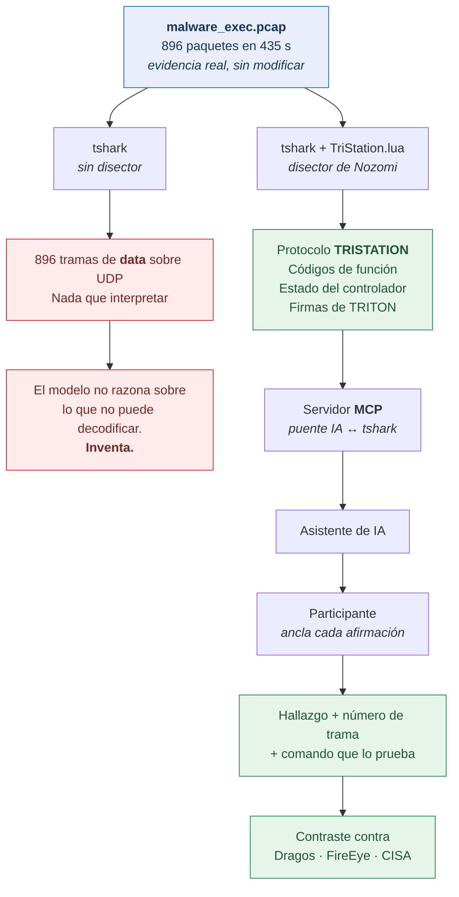
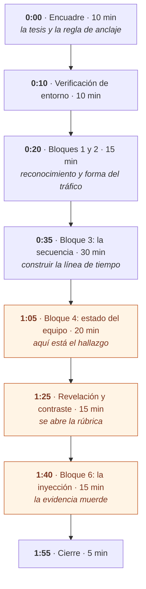

# Taller — Análisis forense de un incidente OT con asistencia de IA

**CyberForce Summit 2026 · Track TECH-COM**

| | |
|---|---|
| **Duración** | 2 horas |
| **Formato** | Hands-on, equipos de 2–3 personas |
| **Nivel** | Intermedio |
| **Requisitos** | VM Linux con `tshark`, un asistente de IA con MCP |
| **Evidencia** | Captura real de TRITON/TRISIS (Nozomi Networks, BSD-3-Clause) |

---

## Qué es esto

Los participantes investigan una intrusión real contra un sistema instrumentado
de seguridad (SIS) industrial usando un asistente de IA conectado a `tshark` vía
MCP, y después contrastan sus hallazgos contra las investigaciones publicadas
por Dragos, FireEye/Mandiant y CISA.

La pregunta del taller no es *"¿qué pasó?"* — eso ya está publicado. Es:

> **¿Puede un analista de IA llegar solo a donde llegaron esas firmas, y cómo
> distingo cuando razona de cuando alucina?**

## Por qué este caso

La evidencia son 896 paquetes en 435 segundos, capturados durante la ejecución
real del malware contra un controlador Triconex.

Sin el disector de protocolo es tráfico UDP opaco: 896 tramas de `data`. Con el
disector es una historia completa de siete minutos, de reconocimiento a
ejecución.

Eso lo hace un banco de pruebas honesto para IA aplicada a forense: **TriStation
es un protocolo propietario y apenas documentado, así que el modelo no puede
resolverlo de memoria.** Tiene que trabajar con la evidencia o inventar — y
ambas cosas se notan.

### La cadena, de un vistazo



Léelo como una bifurcación. El mismo archivo entra por arriba y sale por dos
caminos opuestos, y lo único que los separa son 45 KB de Lua.

**La rama roja es el fracaso silencioso**, y es adonde llegas si el disector no
está instalado o si el proceso corre como root. No hay mensaje de error: el
asistente simplemente ve tráfico opaco y, como no puede decir "no sé", rellena
con lo que recuerda de su entrenamiento. Un reporte fluido, seguro de sí mismo
y falso.

**La rama verde es el taller.** El disector convierte los bytes en códigos de
función, estado del controlador y firmas; el MCP se los entrega al asistente
como resultados de comandos reproducibles; y la regla de anclaje obliga a que
cada afirmación llegue con la trama que la sostiene. Sólo entonces tiene
sentido compararse contra lo que publicaron Dragos, FireEye y CISA.

Todo el diseño del taller vive en esa bifurcación.

## Inicio rápido

En una VM Ubuntu 24.04 limpia, **como usuario sin privilegios**:

```bash
git clone <url-de-este-repo> taller && cd taller
make bootstrap
```

Eso instala todo, descarga la evidencia y verifica la cadena. Salida esperada:

```
[ok] tshark encontrado (TShark (Wireshark) 4.2.2)
[ok] evidencia presente (896 paquetes)
[ok] disector TriStation cargado
[ok] protocolo detectado: TRISTATION
[ok] deteccion TRITON en 2 tramas

LISTO — el taller es viable en esta maquina.
```

Guía detallada de la VM: **[`docs/07-laboratorio-vm.md`](docs/07-laboratorio-vm.md)**

Todo lo que se descarga —y su peso, sus huellas y qué llevar en USB— está
inventariado en **[`docs/11-descargas.md`](docs/11-descargas.md)**.

**¿Ya tienes las cinco líneas en verde?** El siguiente documento es
**[`docs/10-ejecucion.md`](docs/10-ejecucion.md)**: cómo se corre una sesión,
en qué orden, y qué hacer si la IA no está disponible.

> ⚠️ **No uses `sudo` para correr los scripts.** Wireshark deshabilita los
> scripts Lua para superusuario, el disector no carga, y el síntoma es
> silencioso: verás `UDP` en lugar de `TRISTATION`. Es la falla número uno de
> este taller y cuesta media hora encontrarla en vivo.

## Objetivos del Makefile

```
make bootstrap    Provisiona la VM de cero a verificada
make evidence     Descarga la evidencia desde el origen
make verify       Valida la cadena completa
make stats        Resumen rápido de la captura
make triton       Tramas donde el disector detecta TRITON
make check-docs   Verifica que no falte documentación
make hooks        Activa el hook de pre-commit (gitleaks)
```

## Cómo transcurren las 2 horas



Los tres bloques en ámbar son donde ocurre el aprendizaje; el resto los
sostiene.

La primera hora se siente cómoda: los participantes avanzan rápido y se
confían. **El Bloque 4 es donde se atoran**, y no por dificultad técnica sino
porque el dato que buscan es constante — 338 respuestas idénticas se leen como
ruido, y tanto los humanos como los modelos descartan lo que no cambia.

**La revelación** abre la rúbrica y permite medir: qué sacaron de la evidencia,
qué les regaló el modelo de memoria, y qué inventó.

**El Bloque 6** cierra dándole la vuelta al ejercicio: hasta ese momento la
evidencia era algo que se analiza; ahí descubren que también es algo que puede
atacarlos.

## Estructura

```
docs/
  README.md              Índice y orden de lectura
  00-brief-escenario     Brief del participante — se reparte
  01-guia-instructor  ⚠️  Guion minuto a minuto
  02-workbook            Preguntas guiadas — se reparte
  03-rubrica          ⚠️  Verdad de referencia verificada
  04-lecturas            Fuentes primarias y datos de vigencia
  05-inyeccion        ⚠️  Ejercicio de prompt injection
  06-herramientas        La cadena técnica y por qué
  07-laboratorio-vm      Provisión de la VM, paso a paso
  08-publicacion         Checklist para pasar el repo a público
  09-mapeo-attack        Mapeo a MITRE ATT&CK for ICS v19.2
  10-ejecucion           Cómo correr una sesión, y el plan B sin IA
  11-descargas           Inventario de todo lo que hay que descargar
setup/
  SETUP.md               Instalación y trampas conocidas
  mcp-config.example.json
  Dockerfile             Alternativa a la VM
  docker-compose.yml
scripts/
  bootstrap-vm.sh        Provisión completa, idempotente
  fetch-evidence.sh      Descarga desde el origen + huellas SHA-256
  verify-setup.sh        Validación previa al taller
  install-hooks.sh       Activa el hook de pre-commit
.githooks/
  pre-commit             Bloquea commits con secretos o datos personales
prompts/
  00-reglas-de-anclaje   La regla que hace que el ejercicio sirva
  01-baseline            Prompts de arranque (y los que NO usar)
  02-experimento-contaminacion   Recuerdo vs. razonamiento
evidence/
  README.md              Cómo obtener el PCAP y qué esperar
  datos-sinteticos/      Datos ficticios generados para el laboratorio
```

## Datos del laboratorio

**Todo el contexto del escenario es ficticio y fue generado para este
laboratorio:** la empresa cliente (*Industrias ACME de México, S.A. de C.V.*),
la planta, los tickets de cambio, las direcciones IP y las fechas del
escenario. No corresponden a ninguna organización, sistema ni incidente real.

**No hay nombres de personas en ningún artefacto del taller.** Los tickets se
asignan a áreas responsables, nunca a individuos.

La **única** excepción es `malware_exec.pcap`: evidencia auténtica de un caso
público, sin modificar. Ver [`evidence/datos-sinteticos/README.md`](evidence/datos-sinteticos/README.md).


## Integridad de la evidencia

El PCAP es evidencia auténtica de un tercero y **no se modifica**. El ejercicio
de inyección usa artefactos en `evidence/datos-sinteticos/` que son **sintéticos y
fueron creados para este taller**, declarados como tales en su propio README.

Adulterar la evidencia real invalidaría la comparación contra los reportes
públicos, que es el eje del taller.

## Créditos

Evidencia y disector: **Nozomi Networks**, BSD-3-Clause
([tricotools](https://github.com/NozomiNetworks/tricotools)). Este repositorio
no los redistribuye: `scripts/fetch-evidence.sh` los obtiene del origen.

Detalle completo de licencias y procedencia en [`NOTICE.md`](NOTICE.md).
