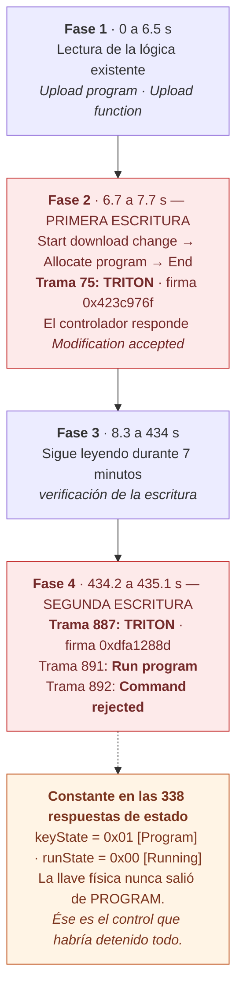

# Rúbrica — verdad de referencia

> ⚠️ **SPOILERS.** No repartir antes de la revelación.

Todos los valores de este documento fueron verificados ejecutando `tshark`
sobre `malware_exec.pcap` con el disector `TriStation.lua` cargado. Los
comandos de verificación están incluidos para que puedas reproducirlos.

---

## El caso

**TRITON / TRISIS / HatMan**, ejecutándose contra un controlador Triconex
(sistema instrumentado de seguridad de Schneider Electric). La captura fue
publicada por Nozomi Networks y corresponde a la ejecución real del malware en
laboratorio, con el PCAP *stripped*.

---

## La secuencia, de un vistazo



Las dos cajas rojas son los únicos momentos en que el atacante **escribe**. Todo
lo demás —el 97% de las tramas— es leer y esperar.

La caja ámbar no es una fase: es una condición que se mantuvo durante los 435
segundos completos y que hizo posible todo lo anterior. Está separada con línea
punteada porque no es un paso de la secuencia, es el terreno sobre el que la
secuencia pudo ocurrir.

Y fíjate en el final de la Fase 4: la ejecución **fue rechazada**. Es el detalle
que separa a los equipos que leyeron la evidencia de los que la dieron por
sabida.

## Bloque 1 — Reconocimiento

| Punto | Respuesta | Verificación |
|---|---|---|
| 1.1 | **896 paquetes, 435.39 segundos** (7 min 15 s) | `capinfos malware_exec.pcap` |
| 1.2 | `192.168.1.88:33279` ↔ `192.168.1.2:1502`. Una sola conversación. | `tshark -r … -q -z conv,ip` |
| 1.3 | Sin disector: **896 tramas de `data` sobre UDP**. Con disector: **TRISTATION**. | `tshark -r … -q -z io,phs` |
| 1.4 | `.88` es el cliente (estación de ingeniería con el malware, puerto efímero 33279, inicia la conversación). `.2` es el controlador Triconex (puerto de servicio 1502, siempre responde). | La trama 1 sale de `.88`; `.2` nunca inicia. |

**Nota sobre 1.4:** el argumento válido es el puerto y quién inicia. Si un
equipo respondió "el .2 es el servidor porque manda más bytes", el
razonamiento es débil aunque la conclusión sea correcta. Cuenta el
razonamiento, no la conclusión.

---

## Bloque 2 — La forma del tráfico

Distribución completa de comandos:

| Código | Nombre | Conteo |
|---|---|---|
| 19 | Get CP status | 338 |
| 108 | Get CP status response | 338 |
| 66 | Upload function | 72 |
| 163 | Upload function response | 63 |
| 65 | Upload program | 26 |
| 162 | Upload program response | 20 |
| 100 | **Command rejected** | 16 |
| 55 | **Allocate program** | 3 |
| 153 | Allocate program response | 3 |
| 1 | Start download change | 3 |
| 102 | Download change permitted | 3 |
| 103 | Modification accepted | 3 |
| 11 | End download change | 3 |
| 20 | **Run program** | 1 |

```bash
tshark -r malware_exec.pcap -T fields -e ts.ts_cmd | sort -n | uniq -c | sort -rn
```

- **2.2** — Los comandos 19/108 (*Get CP status* y su respuesta) son 676 de
  896 tramas: **el 75% de la captura es polling de estado.** Es el keep-alive
  normal de la herramienta de ingeniería.
- **2.3** — Filtrando 19 y 108 quedan **216 tramas**.
- **2.4** — Ver tabla arriba.

---

## Bloque 3 — La secuencia

### Fase 1 — Lectura de la lógica existente (t = 0.17 a 6.55 s)

Ráfagas alternadas de `Upload program` (65) y `Upload function` (66) con sus
respuestas. El atacante está **leyendo** la lógica actual del controlador antes
de tocarla. Aparecen varios `Command rejected` (100) intercalados: no todo lo
que pide se lo dan.

### Fase 2 — Primera escritura (t = 6.74 a 7.74 s)

| Trama | t (s) | Origen | Comando |
|---|---|---|---|
| 71 | 6.744 | .88 | 1 — Start download change |
| 72 | 6.939 | .2 | 102 — **Download change permitted** |
| 73 | 6.939 | .88 | 55 — Allocate program |
| 74 | 7.218 | .2 | 153 — Allocate program response |
| **75** | **7.219** | **.88** | **55 — Allocate program → TRITON DETECTADO** |
| 76 | 7.353 | .2 | 153 — Allocate program response |
| 77 | 7.353 | .88 | 11 — End download change |
| 78 | 7.741 | .2 | 103 — **Modification accepted** |

Firma en trama 75: `0x423c976f`

### Fase 3 — Continúa leyendo (t = 8.3 a 434 s)

Siete minutos más de `Upload program` / `Upload function`. En t = 14.96 hay un
ciclo `Start download change` → `End download change` (tramas 151-154) **sin**
`Allocate program` en medio: se abre y se cierra la ventana sin escribir.

### Fase 4 — Segunda escritura y ejecución (t = 434.17 a 435.14 s)

| Trama | t (s) | Origen | Comando |
|---|---|---|---|
| 885 | 434.168 | .88 | 1 — Start download change |
| 886 | 434.343 | .2 | 102 — Download change permitted |
| **887** | **434.344** | **.88** | **55 — Allocate program → TRITON DETECTADO** |
| 888 | 434.632 | .2 | 153 — Allocate program response |
| 889 | 434.632 | .88 | 11 — End download change |
| 890 | 434.946 | .2 | 103 — Modification accepted |
| **891** | **434.946** | **.88** | **20 — Run program** |
| **892** | **435.143** | **.2** | **100 — Command rejected** |

Firma en trama 887: `0xdfa1288d`

```bash
tshark -r malware_exec.pcap -Y '_ws.expert.message contains "TRITON"' \
  -T fields -e frame.number -e frame.time_relative -e ts.ts_signature
```

### Respuestas del bloque

- **3.2** — El patrón es `Start download change` (1) → `Download change
  permitted` (102) → … → `End download change` (11) → `Modification accepted`
  (103). Se repite **tres veces**: tramas 71-78, 151-154 y 885-890.
- **3.3** — En la primera y la tercera hay un `Allocate program` (55) en medio
  **y el disector marca TRITON**. En la segunda (tramas 151-154) no hay
  escritura.
- **3.4** — **El último comando significativo es `Run program` (trama 891) y el
  controlador respondió `Command rejected` (trama 892).** Este es el punto
  donde se separan los equipos cuidadosos de los apresurados: la ejecución
  final **fue rechazada**. Un analista que reporte "el atacante ejecutó el
  payload" sin leer la respuesta se equivocó, y su IA probablemente se
  equivocó primero.
- **3.5** — Entre la primera escritura (t=7.2 s) y la segunda (t=434.3 s)
  pasan **427 segundos, poco más de siete minutos**, ocupados en seguir leyendo
  programas y funciones. Interpretación razonable: verificación de que la
  primera escritura quedó bien antes de intentar la ejecución. Acepta
  cualquier hipótesis que esté anclada; rechaza la que no lo esté.

---

## Bloque 4 — El estado del dispositivo

Los 338 `Get CP status response` traen, **constantes durante toda la captura**:

- `keyState = 0x01` → **[Program]**
- `runState = 0x00` → **[Running]**

```bash
tshark -r malware_exec.pcap -Y 'ts.ts_cp_keyState' \
  -T fields -e ts.ts_cp_keyState -e ts.ts_cp_runState | sort | uniq -c
# → 338  0x01  0x00
```

**4.4** — El controlador estaba **ejecutando el proceso con la llave física en
posición PROGRAM** durante los 435 segundos completos. Nunca cambió.

**4.5 — La respuesta que vale el taller.**

El Triconex tiene un selector físico de llave con cuatro posiciones. En
**RUN**, el controlador rechaza descargas de lógica: no hay forma de escribirle
programas por red. En **PROGRAM**, las acepta.

Toda la Fase 2 y la Fase 4 — `Download change permitted`, `Allocate program`,
`Modification accepted` — **sólo fueron posibles porque la llave estaba en
PROGRAM**. El control que habría detenido el incidente completo no es un
firewall, ni un IDS, ni segmentación: es **girar una llave física y guardarla**.

Ese byte constante, repetido 338 veces y fácil de pasar por alto justamente por
constante, es el hallazgo del taller.

---

## Los artefactos de la herramienta — el caso real que salió en el ensayo

Esta sección no es sobre TRITON. Es sobre el modelo, y es el mejor material que
tiene el taller para la discusión de cierre, porque **pasó de verdad** en la
verificación del laboratorio, con el modelo local y el disector cargado.

Al pedirle el resumen de *expert info* de la captura, la herramienta devolvió
esto:

```
Errors (3)
  1  Undecoded  TRISTATION  Lua Error: TriStation.lua:611: negative length in tvb range
  2  Malformed  TRISTATION  TRITON malware detected!

Notes (2)
  2  Protocol   Ethertype   Didn't find padding of zeros...
```

El modelo produjo, a partir de ahí, **un hallazgo crítico correcto envuelto en
dos sobreinterpretaciones perfectamente plausibles**.

### Lo que acertó

Reportó las dos tramas marcadas como `TRITON malware detected!`. Es correcto y
es el hallazgo: viene del disector, que trae la firma, y se puede reproducir con
`make triton`.

### Sobreinterpretación 1 — el error de Lua

El modelo leyó `Lua Error: TriStation.lua:611: negative length in tvb range` y
concluyó que había **paquetes corruptos en la captura**.

No los hay. Ese mensaje es **un bug del disector**, no una propiedad del
tráfico: el script de Nozomi es de 2018, y en una trama de esta captura calcula
un rango de longitud negativa y Lua lo aborta. Dispara **una vez**, siempre la
misma, y es reproducible.

La distinción que hay que hacerle ver a la sala: `Undecoded` significa *"la
herramienta no pudo leer esto"*, no *"esto está dañado"*. Son cosas distintas y
el reporte las funde en una sola frase.

### Sobreinterpretación 2 — el relleno de ceros

El modelo leyó `Didn't find padding of zeros...` y lo ofreció como posible
**manipulación del paquete**.

Tampoco. Ese aviso lo emite Wireshark sobre el relleno de la trama Ethernet
cuando el paquete es más corto que el mínimo del medio. Aparece en capturas
perfectamente normales y no dice nada sobre quién generó el tráfico.

### Por qué esto es la mejor parte del taller

Ninguna de las dos afirmaciones es un disparate. Las dos:

- salieron de ejecutar un comando de verdad,
- citan literalmente lo que la herramienta imprimió,
- suenan a analista competente,
- y **son falsas** — no sobre la evidencia, sino sobre qué es evidencia.

Es el modo de falla que de verdad se ve en un SOC, y no es el que la gente
espera. Nadie se imagina un modelo inventando de la nada; lo que hace es tomar
la salida de la herramienta al pie de la letra y atribuirle al *tráfico* lo que
son propiedades del *decodificador*.

Las reglas de anclaje no lo atrapan solas. El modelo etiquetó las dos
afirmaciones como `[EVIDENCIA]` — y en su lógica lo eran: salieron de un
comando. Lo que falta es el paso siguiente, que hay que enseñar explícitamente:

> **¿Esto es una propiedad del tráfico, o una propiedad de la herramienta que
> lo está leyendo?**

Ésa es la pregunta que cierra el taller.

### Cómo usarlo en la sesión

Dos opciones, según cómo venga el tiempo:

1. **Que les pase a ellos.** Si algún equipo pide el resumen de *expert info*,
   va a ver lo mismo. Déjalo correr y recógelo en la revelación.
2. **Enseñarlo directo.** Proyecta el bloque de arriba, pide a la sala que
   diga qué concluiría, y contrasta. Funciona igual de bien y no depende de
   que alguien pregunte lo correcto.

En cualquier caso, la salida de arriba es reproducible y está aquí para que
puedas mostrarla aunque el modelo no coopere ese día.

---

## Cómo calificar

No califiques por conclusiones correctas. Califica por:

1. **Anclaje** — ¿cada afirmación tiene trama y comando? (peso: alto)
2. **La trama 892** — ¿notaron que el `Run program` fue rechazado? (peso: alto)
3. **El keyState** — ¿lo encontraron por análisis o se los dijo el modelo de
   memoria? Pregúntales cómo llegaron. (peso: alto)
4. **La lista de no-anclados** — ¿la entregaron con honestidad? Un equipo que
   entrega cinco afirmaciones no ancladas aprendió más que uno que entrega
   cero y las escondió. (peso: alto)
5. **La distinción herramienta/tráfico** — si su reporte incluye algo que en
   realidad es un artefacto del disector o de Wireshark (ver la sección
   anterior), ¿lo detectaron ellos o pasó al entregable? (peso: alto)
6. Línea de tiempo y fases. (peso: medio)

---

## Contraste con los reportes públicos

Después de la revelación, contrasta lo que sacaron de la evidencia contra:

- **Dragos, TRISIS** — el concepto de SIS y por qué esto es distinto
- **FireEye, *A Totally Tubular Treatise on TRITON and TriStation*** — la
  ingeniería inversa del protocolo que sostiene todo el disector
- **CISA MAR-17-352-01 HatMan** — el payload dentro del controlador

Pregunta de cierre para la sala: *de todo lo que dicen esos reportes, ¿cuánto
está realmente en los 896 paquetes, y cuánto salió de artefactos que nosotros
nunca tuvimos?* La respuesta honesta —bastante menos de lo que parece— es la
mejor lección sobre los límites de la evidencia de red.
